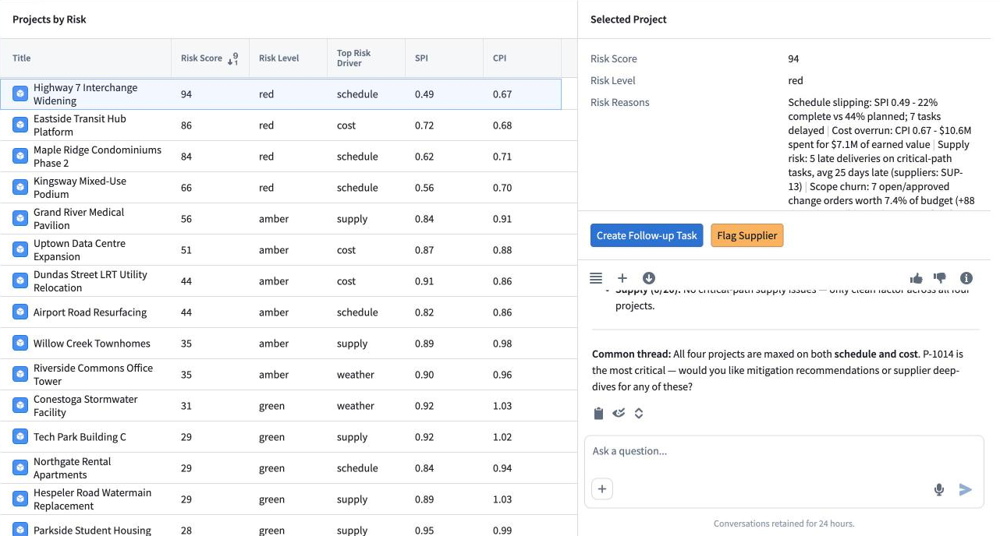
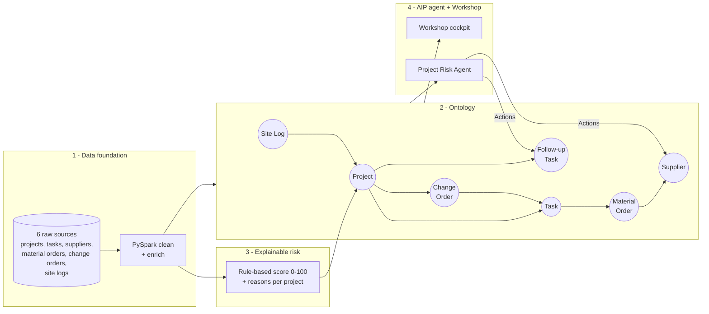
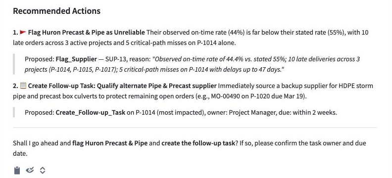
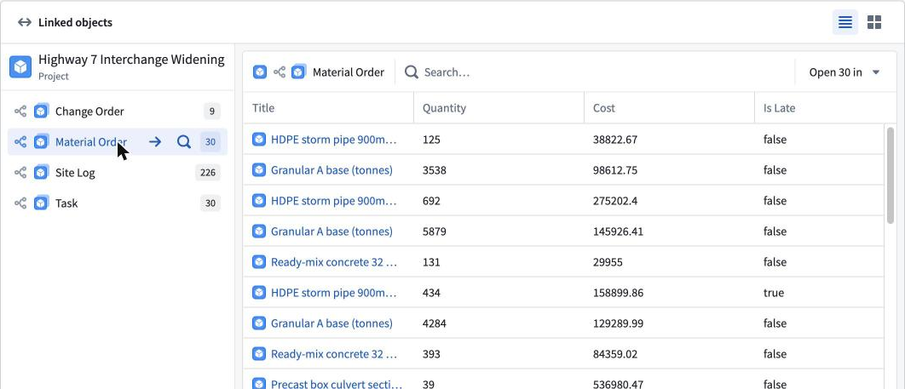
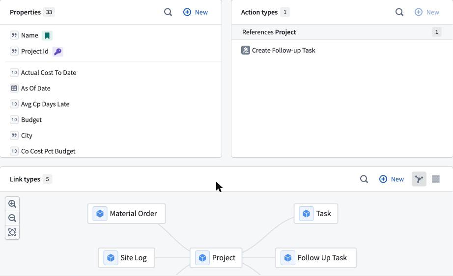
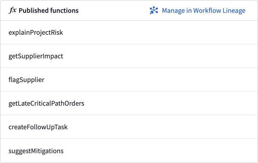
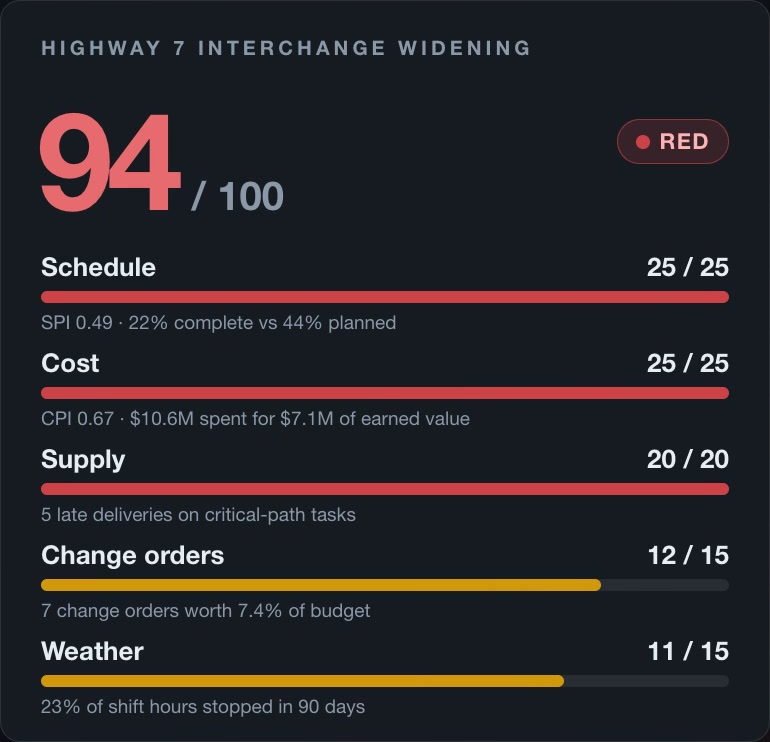

# Construction Project Risk Cockpit: Palantir Foundry + AIP

**An early-warning system that tells construction managers which projects are heading for
delays and cost overruns, why, and what to do about it, while there's still time to
recover cheaply.**

Built on Palantir Foundry: PySpark pipelines → Ontology → explainable risk score →
Workshop dashboard → AIP agent that traces root causes through the Ontology and triggers
governed Actions.

> 📺 **34-second demo video:** [watch with sound](https://github.com/user-attachments/assets/5ea45460-9500-4673-a9da-2751c5f59169) &nbsp;·&nbsp; 🧭 **Setup guide:** [docs/foundry_setup.md](docs/foundry_setup.md)

[](docs/demo.mp4)

**The published Workshop app:** every project ranked by risk, with the reasons and one-click Actions.



---

## The problem

A general contractor's warning signs live in different systems:

| Signal | Where it usually lives | Who sees it |
|---|---|---|
| Budget vs. cost to date | ERP / accounting | Finance, monthly |
| Task dates & critical path | P6 / MS Project | Scheduler |
| Supplier deliveries | Procurement / email | Buyer |
| Change orders | PM tool / spreadsheets | PM, contracts |
| Crew counts, weather, stoppages | Daily site logs | Superintendent |

No one connects *"the precast supplier is 6 weeks late"* to *"that culvert is on the critical
path"* to *"this job will blow its schedule and budget"* until the monthly cost report, and by
then recovery is expensive.

## The solution: 4 layers



1. **Data foundation.** Six source extracts, typed and de-duplicated in PySpark
   ([risk_logic.py](foundry/transforms-python/src/construction_risk/risk_logic.py)), then
   enriched with derived fields (days late, critical-path flags, start slippage).
2. **Ontology.** The business's own nouns as objects with links:
   `Project → Task → MaterialOrder → Supplier`, `ChangeOrder → Task`, `SiteLog → Project`,
   plus a writeback `FollowUpTask`. Apps and the agent work on *objects*, not tables.
3. **Explainable risk score.** A transparent weighted score, no black-box ML, so a PM can
   check any number by hand (details below).
4. **AIP agent.** Answers *"Why is Project X at risk?"* by calling Ontology-aware functions,
   traces the root cause to a specific supplier and task, proposes mitigations from a
   rule-based playbook, and, after human confirmation, executes **Actions** (flag supplier,
   create follow-up task) that write back to the Ontology with a full audit trail.



## Risk score: how it works

| Factor | Weight | Metric | 0 points at | Full points at |
|---|---:|---|---|---|
| Schedule | 25 | SPI = % complete ÷ % planned (duration-weighted from tasks) | SPI ≥ 1.00 | SPI ≤ 0.70 |
| Cost | 25 | CPI = earned value ÷ actual cost | CPI ≥ 1.00 | CPI ≤ 0.75 |
| Supply | 20 | Late deliveries (>2 days) on **critical-path** tasks: ½ count, ½ avg days late | 0 | 5 orders / 14 days |
| Change orders | 15 | Non-rejected COs: ½ count, ½ cost as % of budget | 0 | 10 COs / 8% |
| Weather | 15 | % of shift hours stopped, trailing 90 days | 0% | 30% |

Points ramp linearly between the two thresholds. **Green < 35 ≤ Amber < 60 ≤ Red.**
Any factor earning ≥ 40% of its weight becomes a plain-English reason, e.g. for P-1014:

```
Highway 7 Interchange Widening: 94 / 100, RED
  - Schedule slipping: SPI 0.49 - 22% complete vs 44% planned; 7 tasks delayed
  - Cost overrun: CPI 0.67 - $10.6M spent for $7.1M of earned value
  - Supply risk: 5 late deliveries on critical-path tasks, avg 25 days late (suppliers: SUP-13)
  - Scope churn: 7 open/approved change orders worth 7.4% of budget (+88 days claimed)
  - Weather: 23% of shift hours stopped in last 90 days (141 h)
```

**Why rules, not ML?** With 20 projects there's nothing credible to train on, and in
construction a score nobody can explain doesn't get acted on. The weights are a starting
point to tune with the client's PMs. Later, an ML model can be validated *against* this baseline.

## Results on the synthetic portfolio

20 Ontario projects ($1.0B total), as of 2026-03-15:

| Risk level | Projects | Budget |
|---|---:|---:|
| 🔴 Red | 4 | $214M |
| 🟠 Amber | 6 | $314M |
| 🟢 Green | 10 | $474M |

The data generator injects problems through **causes** (slow crews, cost overruns, change-order
churn, reliance on three chronically late suppliers, Jan/Feb 2026 cold snap and snowstorm), never
by labelling projects. The score independently identifies all four troubled projects, and the
supplier scorecard flags all three chronic suppliers. This is enforced in
[tests/test_risk_scoring.py](tests/test_risk_scoring.py).

## Business impact

- **Earlier warning.** Supply and change-order signals show up weeks before they surface in
  monthly cost reports. The agent connects a late culvert delivery to the critical path the day it slips.
- **Portfolio-level supplier leverage.** One supplier (Huron Precast & Pipe) is hurting three
  projects at once; that only becomes visible when procurement data is linked across jobs.
- **Faster, consistent decisions.** "Why is this red and what do we do?" goes from a half-day of
  spreadsheet archaeology to a 30-second conversation, and the mitigation is executed as a governed,
  audited Action rather than an email.
- **Trust.** Every number traces to a rule and a record; humans confirm every write.

## Repository layout

```
├── src/
│   ├── generate_data.py          # seeded synthetic data (Faker + numpy)
│   └── risk_scoring.py           # pandas reference implementation of the score
├── foundry/
│   ├── transforms-python/src/construction_risk/
│   │   ├── risk_logic.py         # pure PySpark logic (runs in Foundry and locally)
│   │   ├── config.py             # dataset paths + as-of date
│   │   ├── pipeline.py
│   │   └── datasets/             # @transform_df wrappers: clean.py, ontology.py
│   └── functions-typescript/src/index.ts   # AIP agent tools + Action edit functions
├── spark/run_local.py            # run the PySpark pipeline locally
├── tests/                        # determinism, red-detection, pandas↔Spark parity
├── data/raw/                     # generated CSVs (upload these to Foundry)
├── data/output/                  # reference scores to validate Foundry against
└── docs/
    ├── foundry_setup.md          # step-by-step Foundry + AIP guide
    ├── demo_script.md            # 2-minute demo script
    ├── demo.mp4                  # 34-second demo video
    └── screenshots/              # Foundry screenshots used in this README
```

## Run it locally

```bash
python -m venv .venv && source .venv/bin/activate
pip install -r requirements.txt
python src/generate_data.py           # writes data/raw/*.csv (seed 42, as-of 2026-03-15)
python src/risk_scoring.py            # writes data/output/*.csv and prints the ranking
pytest -q                             # Spark parity tests run if pyspark + Java are installed
```

**PySpark locally (optional).** Needs Java 17. Any JDK works; to keep it project-local:

```bash
pip install "pyspark>=3.5,<3.6"
mkdir -p .jdk && curl -fsSL "https://api.adoptium.net/v3/binary/latest/17/ga/mac/aarch64/jdk/hotspot/normal/eclipse" | tar -xz -C .jdk
export JAVA_HOME="$(ls -d "$PWD"/.jdk/jdk-17*)/Contents/Home" PATH="$JAVA_HOME/bin:$PATH"
python spark/run_local.py             # same risk_logic.py that runs in Foundry -> data/output_spark/
pytest -q                             # 10 tests incl. exact pandas == Spark parity (scores, reasons, suppliers)
```
(Use `linux/x64` or `mac/x64` in the URL on other machines.)

## Tech

Palantir Foundry (Code Repositories, Pipeline Builder, Ontology Manager, Actions, Workshop,
AIP Agent Studio, AIP Logic), PySpark, TypeScript Functions, Python (pandas, numpy, Faker).

## Screenshots

| | |
|---|---|
|  Project drill-down: linked change orders, material orders, site logs and tasks |  Ontology Manager: Project properties, Actions and link types |
|  Published TypeScript functions (agent tools + Action edits) |  Explainable score for P-1014 (from the demo video) |

---

*All data is synthetic. Company, project, and supplier names are fictional.*
